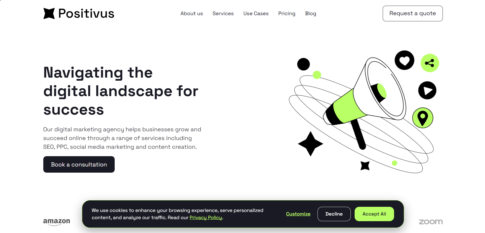

# Positivus Landing Page

A responsive, single-page landing page for a digital marketing agency, built with HTML, CSS, and JavaScript.

## Preview



**Live demo:** [View the project](https://aden1109.github.io/positivus/)

> Replace the placeholder URL above with your GitHub Pages link after publishing the project.

## Features

- Responsive layout for desktop, tablet, and mobile screens
- Keyboard-accessible mobile navigation
- Working-process accordion
- Testimonial carousel
- Client-side contact form validation
- One-second simulated form submission without a backend
- Cookie preferences dialog with settings saved in `localStorage`

## Project Structure

```text
index.html
css/
  reset.css
  style.css
  media.css
js/
  script.js
images/
    preview.png
README.md
```

## Note

The contact form is a demonstration only. It does not send data to a server and resets after the simulated submission completes.

## Technologies

- HTML5
- CSS3
- Vanilla JavaScript
